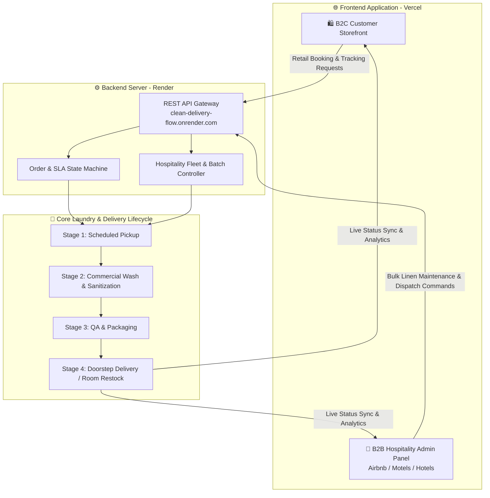

# 🚚 Clean Delivery Flow
### Full-Stack Dual-Ecosystem (B2C & B2B Hospitality) Laundry Logistics & Maintenance Platform

---

## 📌 Project Overview

**Clean Delivery Flow** is a decoupled, full-stack laundry, linen maintenance, and logistics platform engineered to serve both **individual consumers (B2C)** and **commercial hospitality partners (B2B)** under a unified architecture. 

While the public-facing storefront streamlines on-demand household laundry bookings and doorstep deliveries, the dedicated **B2B Admin & Operations Panel** is purpose-built for high-turnover hospitality businesses—specifically **Airbnbs, Motels, Boutique Hotels, and Serviced Apartments**—to automate bulk linen turnaround, room-turnover laundry maintenance, and scheduled fleet dispatch.

The platform runs on a distributed cloud architecture, pairing an edge-deployed **Vercel Frontend** with a dedicated RESTful **Backend API hosted on Render**.

---

## 🌐 Live Deployments & Environments

| Environment | URL | Hosting Provider | Status |
| :--- | :--- | :--- | :--- |
| **Frontend Web Application (B2C & B2B UI)** | [https://clean-delivery-flow.vercel.app/](https://clean-delivery-flow.vercel.app/) | **Vercel** (Edge CDN) | 🟢 Active |
| **Backend REST API Server** | [https://clean-delivery-flow.onrender.com](https://clean-delivery-flow.onrender.com) | **Render** (Cloud Web Service) | 🟢 Active |
| **Source Code Repository** | [github.com/MRjayed1/clean-delivery-flow](https://github.com/MRjayed1/clean-delivery-flow) | **GitHub** | 🟢 Public |

> **⚡ Reviewer Note on Backend Cold Starts:** The backend service is hosted on Render's cloud instance (`clean-delivery-flow.onrender.com`). If the API has been idle for 15+ minutes, the initial API request may take **30–50 seconds** to wake up the container. Subsequent requests execute with sub-second latency.

---

## 🏢 Dual-Sided Business Architecture (B2C + B2B)

| Dimension | 🛍️ B2C Customer Storefront (Front Page) | 🏨 B2B Hospitality & Admin Portal |
| :--- | :--- | :--- |
| **Target Audience** | Individual households, students, and daily residential clients | Airbnb hosts, Motel operators, Hotel facility managers, & Commercial properties |
| **Primary Use Case** | On-demand personal garment care, dry cleaning, and wash-and-fold | Bulk linen & towel sanitation, between-guest turnover syncing, and recurring maintenance contracts |
| **Order Volume** | Per-bag or per-item retail orders | High-volume batch processing (by weight/linen count) & multi-property SLA tracking |
| **Scheduling Flow** | Flexible pickup/drop-off time slot booking | Automated recurring route dispatches aligned with guest check-out/check-in windows |
| **Management Tools** | Instant price estimation, order tracking, and digital receipts | Fleet dispatch control, property-wise invoicing, stain/damage reporting, and inventory health |

---

## 🖼️ Live Interface Previews

> *The views below are dynamically rendered from the active production deployment on Vercel.*

### 1. B2C Storefront & Primary Application View

  
  
<em>B2C Customer Landing & Booking Interface (1280x800) — Click image to launch live application</em>

### 2. Multi-Viewport Operations (B2B Dispatch & Mobile Courier Views)
| 💻 Widescreen B2B / Dispatch Viewport | 📱 Mobile Customer & Field Rider Viewport |
| :---: | :---: |
|  |  |
| *Commercial Operations & Order Overview* | *On-the-Go Booking & Rider Status Updates* |

---

## ✨ Key Features

### 🛍️ B2C Consumer Front-End
* **Instant Service Booking:** Frictionless scheduling for wash-and-fold, dry cleaning, and express garment care.
* **Transparent Pricing & Slot Selection:** Real-time service categorization and convenient doorstep pickup/delivery window selection.
* **Live Order Progression:** Visual step-by-step tracking from *Pickup Scheduled* to *Delivered*.

### 🏨 B2B Admin & Hospitality Maintenance Panel (Airbnb, Motels & Hotels)
* **Hospitality Property Management:** Centralized oversight for multi-unit Airbnb hosts, motels, and hotels requiring strict linen turnaround SLAs between guest stays.
* **Bulk Linen & Turnover Pipeline:** Specialized workflow stages (*Dirty Linen Pickup $\rightarrow$ Commercial Wash/Sanitization $\rightarrow$ Quality & Stain Inspection $\rightarrow$ Crisp Folding/Packaging $\rightarrow$ Property Restock*).
* **Commercial Dispatch & Route Coordination:** Assign and monitor pickup/delivery fleets across multiple hotel/motel locations simultaneously.
* **Operational KPIs & SLA Monitoring:** Real-time visibility into active commercial loads, pending hospitality pickups, turnaround velocity, and facility capacity.

### ⚙️ Backend API & Service Layer (Render)
* **Unified RESTful API:** Handles order lifecycle state transitions, B2B property maintenance schedules, and customer booking payloads.
* **Role & Workflow Segregation:** Separates retail B2C booking transactions from high-volume B2B hospitality batch operations.
* **CORS & Security Middleware:** Configured for secure cross-origin communication between the Vercel client (`clean-delivery-flow.vercel.app`) and the Render API (`clean-delivery-flow.onrender.com`).

---

## 🏗️ Full-Stack System Architecture

